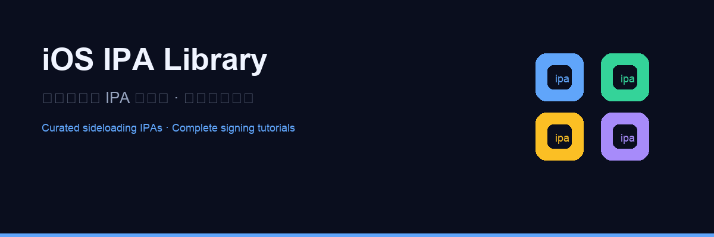

<p align="center">
  
</p>

# iOS IPA Library 🍎

> 精選可側載 iOS IPA 收納庫＋完整簽名教學 — 收錄不同種類嘅開源／免費應用，教你點樣簽名裝上自己部電話。

**🌐 Language:** 中文 | [English](README_EN.md)


---

## ⚠️ 重要聲明（必讀）

**本收納庫只收錄「開源／免費／你有權限使用」嘅應用，唔包含任何破解或盜版 app。**

- ✅ 開源項目（GitHub 上公開源碼）
- ✅ 免費軟體（官方發佈嘅免費 IPA）
- ✅ 你自己開發／有授權側載嘅 app
- ❌ **唔收錄**破解版、付費 app 偷雞版、App Store 收費 app 嘅盜版

側載嘅目的係：**用自己嘅 Apple ID 簽名安裝你合法擁有嘅應用**，用喺自己部機。簽名方法全部係 Apple 容許嘅開發者流程。

> 請尊重開發者：用 App Store 係最正規嘅途徑。側載僅適用於開源／免費／自製應用。

---

## 📦 收納庫：唔同種類嘅可側載 IPA

收納庫按「種類」分類，每個種類都列出**開源／免費**代表項目（附來源連結），唔會直接放 IPA 檔（版權問題），而係話你知**邊度攞到＋點樣自己 Build／簽名**。

### 🗂️ 種類一覽

| 種類 | 內容 | 文章 |
|------|------|------|
| 🎮 遊戲 | 開源遊戲、模擬器（RetroArch 等） | [categories/games.md](categories/games.md) |
| 🛠️ 開發工具 | 開發者工具、Git 客戶端、Terminal | [categories/dev-tools.md](categories/dev-tools.md) |
| 📚 學習／閱讀 | 開源閱讀器、電子書、學習 App | [categories/learning.md](categories/learning.md) |
| 🔧 系統工具 | 檔案管理、系統監控、網絡工具 | [categories/system-tools.md](categories/system-tools.md) |
| 🎨 創意工具 | 開源繪畫、音樂、影片編輯 | [categories/creative.md](categories/creative.md) |
| 🕸️ 網絡／通訊 | 開源即時通訊、瀏覽器 | [categories/network.md](categories/network.md) |
| 🎵 影音播放 | 開源媒體播放器 | [categories/media.md](categories/media.md) |
| 🧩 其他實用 | 其他開源好物 | [categories/misc.md](categories/misc.md) |

> 每個種類文章會寫：**推薦項目＋來源（GitHub/官網）＋簡單安裝指引**。

### 🔗 100 個可側載開源 IPA 大全

👉 **[catalog.md](catalog.md)** — 100 個開源/免費 iOS 應用，**全部附上官方 GitHub 連結**，按種類分好，即刻揀嚟裝。

---

## ✍️ 簽名教學（重點）

想將 IPA 裝上 iPhone/iPad，必須「簽名」。以下係完整教學系列：

| 篇 | 主題 | 文章 |
|----|------|------|
| 01 | 簽名係咩？IPA／簽名／憑證基礎概念 | [signing/01-basics.md](signing/01-basics.md) |
| 02 | Apple ID 免費簽名（7 日有效期） | [signing/02-free-appleid.md](signing/02-free-appleid.md) |
| 03 | 用 Sideloadly 簽名安裝（Windows/Mac） | [signing/03-sideloadly.md](signing/03-sideloadly.md) |
| 04 | 用 AltStore 簽名＋自動續期 | [signing/04-altstore.md](signing/04-altstore.md) |
| 05 | 用 TrollStore 安裝（支援設備限定） | [signing/05-trollstore.md](signing/05-trollstore.md) |
| 06 | 用開發者帳號（$99/年）簽名無效期 | [signing/06-developer-account.md](signing/06-developer-account.md) |
| 07 | 簽名工具大全對比＋注意事項 | [signing/07-tools-comparison.md](signing/07-tools-comparison.md) |
| 08 | 常見問題 FAQ | [signing/08-faq.md](signing/08-faq.md) |
| 09 | **LiveContainer：一次過跑無限個 app** | [signing/09-livecontainer.md](signing/09-livecontainer.md) |

---

## 🚀 最快上手機（3 步）

```bash
# 1. 揀一個開源 IPA（例如 GitHub 上嘅開源 app）
#    開源項目通常提供已編譯 IPA 或教你自行 Build

# 2. 揀簽名方式（免費 Apple ID 最簡單）
#    見 signing/02-free-appleid.md

# 3. 安裝
#    Windows/Mac 用 Sideloadly 或 AltStore
```

---

## 📚 完整學習路徑

```
新手
  │
  ├─ 01 簽名基礎概念（唔明就唔好裝）
  │
  ├─ 02 免費 Apple ID 簽名（最快起步）
  │
  ├─ 03 Sideloadly 實戰（Windows/Mac 通用）
  │
  ├─ 04 AltStore 自動續期（長期使用）
  │
  ├─ 05 TrollStore（若你部機支援）
  │
  └─ 06 開發者帳號（專業／大量安裝）
進階
```

---

## 🤝 貢獻

想加一個開源 app 入收納庫？想加一篇教學？歡迎 PR！

要求：
- 只收**開源／免費／合法**項目
- 附來源連結（GitHub／官網）
- 教學文章結構清晰、步驟可重複

---

## 📄 License

MIT — 自由使用、修改、轉載（請保留聲明）。