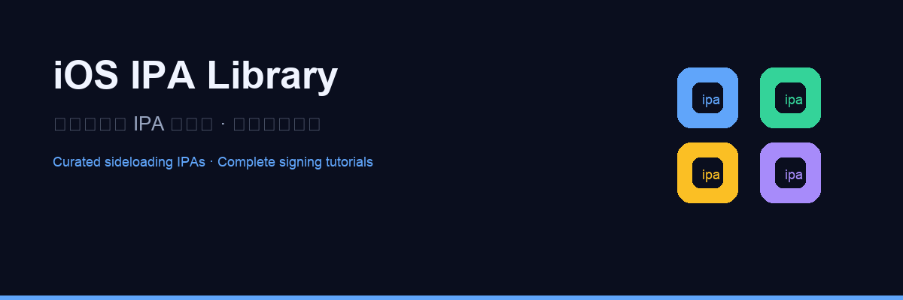

<p align="center">
  
</p>

# iOS IPA Library 🍎

> A curated collection of sideloadable iOS IPAs plus complete signing tutorials — different categories of open-source / free apps, and how to sign and install them on your own phone.

**🌐 Language:** [中文](README.md) | English


---

## ⚠️ Important Notice (read first)

**This library only collects open-source / free / apps you are licensed to use. No cracked or pirated apps.**

- ✅ Open-source projects (public source code on GitHub)
- ✅ Free software (officially released free IPAs)
- ✅ Apps you developed yourself or are authorized to sideload
- ❌ **No** cracked apps, pirated paid apps, or stolen App Store apps

The purpose of sideloading: **sign and install apps you legally own onto your own device using your own Apple ID.** All signing methods described here are Apple-permitted developer workflows.

> Respect developers: the App Store is the proper channel. Sideloading is for open-source / free / self-made apps.

---

## 📦 Collection: Different Categories of Sideloadable IPAs

The collection is organized by category. Each category lists **open-source / free** representative projects (with source links). We don't host IPA files directly (copyright); instead we tell you **where to get them and how to build / sign them yourself.**

### 🗂️ Categories

| Category | Content | Article |
|----------|---------|---------|
| 🎮 Games | Open-source games, emulators (RetroArch, etc.) | [categories/games.md](categories/games.md) |
| 🛠️ Dev Tools | Developer tools, Git clients, Terminal | [categories/dev-tools.md](categories/dev-tools.md) |
| 📚 Learning / Reading | Open-source readers, e-books, study apps | [categories/learning.md](categories/learning.md) |
| 🔧 System Tools | File managers, system monitoring, network tools | [categories/system-tools.md](categories/system-tools.md) |
| 🎨 Creative Tools | Open-source drawing, music, video editing | [categories/creative.md](categories/creative.md) |
| 🕸️ Network / Comms | Open-source messengers, browsers | [categories/network.md](categories/network.md) |
| 🎵 Media Players | Open-source media players | [categories/media.md](categories/media.md) |
| 🧩 Misc Utilities | Other open-source gems | [categories/misc.md](categories/misc.md) |

> Each category article covers: **recommended projects + source (GitHub/website) + simple install guidance.**

---

## ✍️ Signing Tutorials (the core)

To install an IPA on iPhone/iPad, you must "sign" it. Here's the complete tutorial series:

| No. | Topic | Article |
|-----|-------|---------|
| 01 | What is signing? IPA / signing / certificate basics | [signing/01-basics.md](signing/01-basics.md) |
| 02 | Free Apple ID signing (7-day validity) | [signing/02-free-appleid.md](signing/02-free-appleid.md) |
| 03 | Sideloadly install (Windows/Mac) | [signing/03-sideloadly.md](signing/03-sideloadly.md) |
| 04 | AltStore + auto-renew | [signing/04-altstore.md](signing/04-altstore.md) |
| 05 | TrollStore install (supported devices only) | [signing/05-trollstore.md](signing/05-trollstore.md) |
| 06 | Developer account ($99/yr) — no expiry | [signing/06-developer-account.md](signing/06-developer-account.md) |
| 07 | Signing tool comparison + safety | [signing/07-tools-comparison.md](signing/07-tools-comparison.md) |
| 08 | FAQ | [signing/08-faq.md](signing/08-faq.md) |

---

## 🚀 Fastest Way to Get an App on Your Phone (3 steps)

```bash
# 1. Pick an open-source IPA (e.g., an open-source app on GitHub)
#    Open-source projects usually ship a compiled IPA or teach you to build

# 2. Pick a signing method (free Apple ID is easiest)
#    See signing/02-free-appleid.md

# 3. Install
#    Use Sideloadly or AltStore on Windows/Mac
```

---

## 📚 Learning Path

```
Beginner
  │
  ├─ 01 Signing basics (don't install before you understand)
  │
  ├─ 02 Free Apple ID signing (fastest start)
  │
  ├─ 03 Sideloadly hands-on (Windows/Mac)
  │
  ├─ 04 AltStore auto-renew (long-term use)
  │
  ├─ 05 TrollStore (if your device supports it)
  │
  └─ 06 Developer account (professional / bulk installs)
Advanced
```

---

## 🤝 Contributing

Want to add an open-source app to the collection, or a tutorial? PRs welcome!

Requirements:
- Only **open-source / free / legal** projects
- Include a source link (GitHub / official site)
- Tutorial articles must be clear and reproducible

---

## 📄 License

MIT — free to use, modify, and redistribute (please keep the notice).